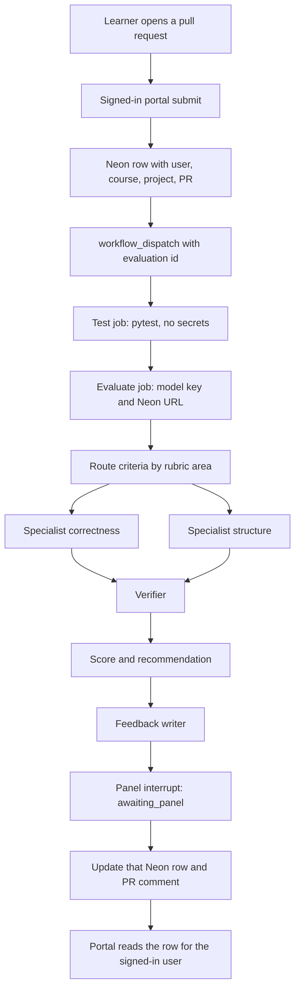

# Learner evaluation POC

The academy portal owns identity. A learner raises a pull request, then submits that URL while signed in. The portal writes the Neon row with the academy user, course, and project, and dispatches this repo. Actions does not discover who the learner is.

A GitHub webhook is not the trigger. The webhook only knows a repository, a pull request number, and a GitHub login. It does not know the academy user or which course attempt the pull request belongs to.

## Layout

- **This repo** (`langraph-actions-poc`): instructor packs, unit tests, LangGraph package, `workflow_dispatch` on `main`. Secrets here are `OPENAI_API_KEY` and `DATABASE_URL`. Learners cannot push.
- **Submission repo**: starter and learner code only. No model key, no rubric, no evaluator workflow. For the POC the pull request can be on this same repo. Packs are read from `main`; only the manifest's submission paths are read from the PR head. Workflow inputs already take `submission_repo` and `pr_number`, so a separate submission repo is a configuration change later.
- **Vercel portal**: authenticated submit. That route is not in this workspace. This POC includes the Neon table, the Actions updater, and a shell stand-in that does what the portal will do.

Packs stay in this repo. A submodule in the submission repo would not help: the learner controls that gitlink, and a reusable workflow still takes its secrets from the caller.

## What the POC proves

- A known evaluation id plus a pull request number runs that project's instructor tests against the PR head, using tests from `main`.
- The graph scores the fixed rubric and recommends pass, borderline, or fail. It does not certify the learner.
- The run ends at `awaiting_panel` and the runner exits.
- The portal reads the row it created. Actions only fills in the result.

Out of scope: the Vercel route itself, push-triggered reruns, panel resume, and a GitHub App.

## Flow

The portal route, when it is added to the Vercel app:

- Authenticated `POST` with course id, project id, and pull request URL.
- Parse owner, repo, and number. Confirm the pull request exists.
- Insert `evaluation_runs` with `portal_user_id` from the session, plus course, project, repo, and pull request number. Status `pending`.
- `POST /repos/praminda-pocketcfo/langraph-actions-poc/actions/workflows/project-evaluation.yml/dispatches` with `ref=main` and inputs `evaluation_id`, `submission_repo`, `pr_number`, `project_id`.
- The dispatch token lives in Vercel. The submission repo has no secrets.

Until that route exists, [scripts/submit_evaluation.sh](scripts/submit_evaluation.sh) inserts the row with a caller-supplied `portal_user_id` and runs `gh workflow run`. That is the POC stand-in, not a second identity system.

## Stage 1: tests

Pack at [packs/word_counter](packs/word_counter):

- `rubric.yaml`, `tests/test_word_counter.py`, and `manifest.yaml`.
- The manifest names the project id and the submission paths to fetch, such as `word_counter.py`.
- [fixtures/word_counter_partial](fixtures/word_counter_partial) is the partial solution for dry-run. A dispatch without a pull request can point at this fixture.

Test job, with no secrets in the pytest step:

- Checkout this repo at `main`.
- Download the PR head as a zip or via the contents API. Do not run anything from the pull request except the submission files named in the manifest.
- Overlay `packs/<id>/tests` from this checkout.
- `persist-credentials: false`. Unset `GITHUB_TOKEN`, `OPENAI_API_KEY`, and `DATABASE_URL` for pytest.
- Upload JUnit. Failures do not skip the graph. They feed a code-scored criterion.
- If the project id does not match a pack, set the existing row to `status=error` and stop before any model call. Do not insert a row.

## Stage 2: the graph

Python package [evaluator](evaluator), run as `python -m evaluator`. Dependencies in [requirements.txt](requirements.txt): `langgraph`, `langchain`, `langchain-openai`, `pyyaml`, `pytest`, `psycopg[binary]`. Model via `init_chat_model`. Secret `OPENAI_API_KEY`. Optional `EVAL_MODEL`, default `gpt-4o-mini`.

State: evaluation id, PR metadata, project id, truncated submission files, JUnit summary, rubric, specialist findings, verified levels, score, feedback, status.

Nodes:

1. **Route (code).** Group criteria by `area`. Criteria with `mode: tests` skip the specialists.
2. **Specialists (parallel).** LangGraph `Send`, one call per area. The sample rubric has `correctness` and `structure`. Each returns `missing`, `partial`, or `met`, plus a short evidence quote.
3. **Verifier (one model call).** May downgrade a level. It cannot add criteria or change points.
4. **Score (code).** Map levels to rubric points. `pass` at 70, `borderline` at 50, otherwise `fail`.
5. **Feedback writer (one model call).** Learner-facing markdown. It does not change points.
6. **Panel (interrupt).** `interrupt()` after feedback. Status becomes `awaiting_panel`. The runner reads `graph.get_state()` and publishes. Resume is not wired.

`--dry-run` uses a fake model and does not touch Neon. Push to `main` runs `pytest` for routing, scoring, and the fixture.

## Neon

Schema in [db/evaluation_runs.sql](db/evaluation_runs.sql). `portal_user_id` is `text` so it can match the portal's user id without a foreign key this repo does not know.

Columns the portal writes on insert:

- `id` uuid
- `portal_user_id`, `course_id`, `project_id`
- `submission_repo`, `pr_number`, `head_sha`
- `status` = `pending`

Columns Actions updates on that id:

- `status`: `running`, then `awaiting_panel` or `error`
- `recommendation`: `pass`, `borderline`, or `fail`
- `result` jsonb, `state` jsonb, `github_run_url`, `head_sha` if it changed

Actions never writes `portal_user_id`, `course_id`, or `project_id`. If `evaluation_id` is missing, the job fails.

The portal reads rows for the signed-in user, or one row by id:

`select * from evaluation_runs where id = $1 and portal_user_id = $2`

`result` jsonb:

- `version`, `evaluation_id`, `pr`, `project_id`, `head_sha`, `run_url`
- `test`: passed, failed, errors
- `criteria[]`: id, area, level, points, max, evidence
- `total`, `max`, `recommendation`, `status`, `feedback_markdown`

The evaluate job also upserts one pull request comment containing `<!-- learner-evaluation:v1 -->` and the same summary. On a same-repo POC, `GITHUB_TOKEN` with `pull-requests: write` is enough. A separate submission repo needs a fine-grained `SUBMISSION_TOKEN` on this repo only.

## Workflow

[.github/workflows/project-evaluation.yml](.github/workflows/project-evaluation.yml)

- `workflow_dispatch` inputs: `evaluation_id`, `submission_repo`, `pr_number`, `project_id`
- Concurrency group per evaluation id, cancel in progress
- Job `test`: contents read, no secrets in pytest
- Job `evaluate`: needs test; `OPENAI_API_KEY` and `DATABASE_URL` only here; never imports submission code; updates the row by `evaluation_id`
- No `pull_request`, no `pull_request_target`, and no webhook

[.github/workflows/ci.yml](.github/workflows/ci.yml) on push to `main`: dry-run `pytest` only.

## Later, not built now

A new push does not start an evaluation by itself. If auto-rerun is wanted later, a webhook may look up an existing row by repository and pull request number and dispatch that `evaluation_id`. No matching row means ignore the event.

Panel review is a portal action by a reviewer on that same row. It dispatches again with the human decision and resumes from `state`. A comment on the pull request is not the source of identity.

## Setup outside the code

- Apply [db/evaluation_runs.sql](db/evaluation_runs.sql) to Neon.
- This repo's secrets: `OPENAI_API_KEY`, `DATABASE_URL`.
- Run the submit script with a portal user id, a project id, and a pull request number. Confirm the same Neon row moves from `pending` to `awaiting_panel`, and that the pull request has the summary comment.

